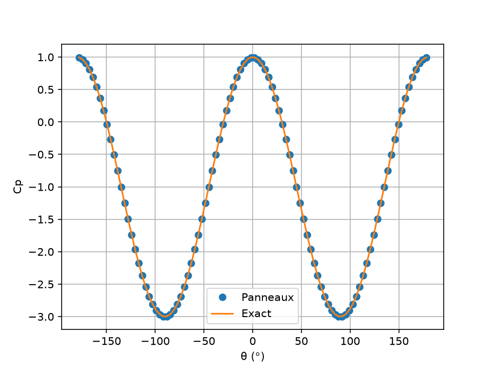
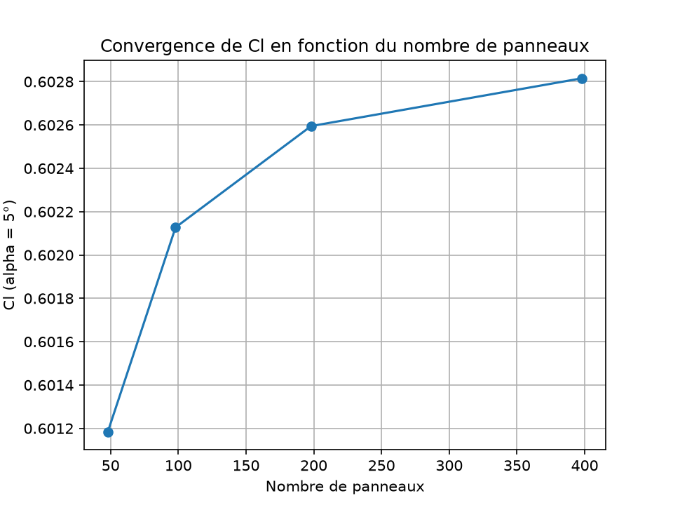
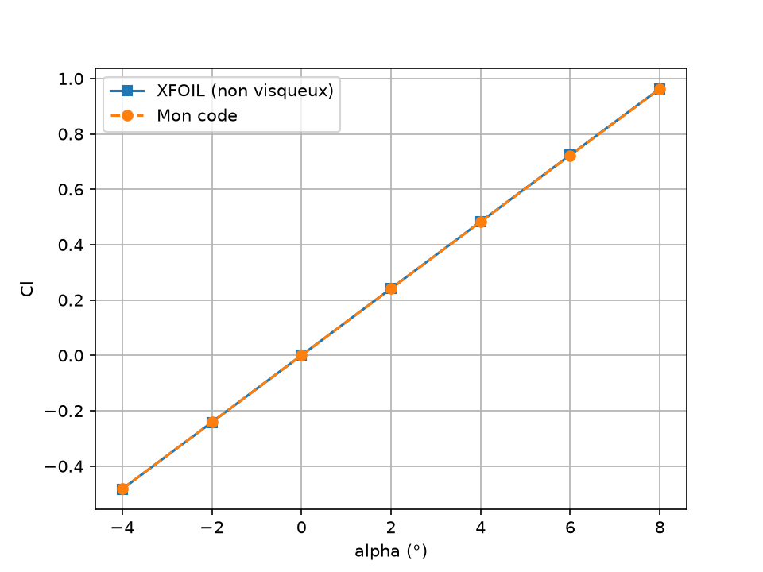
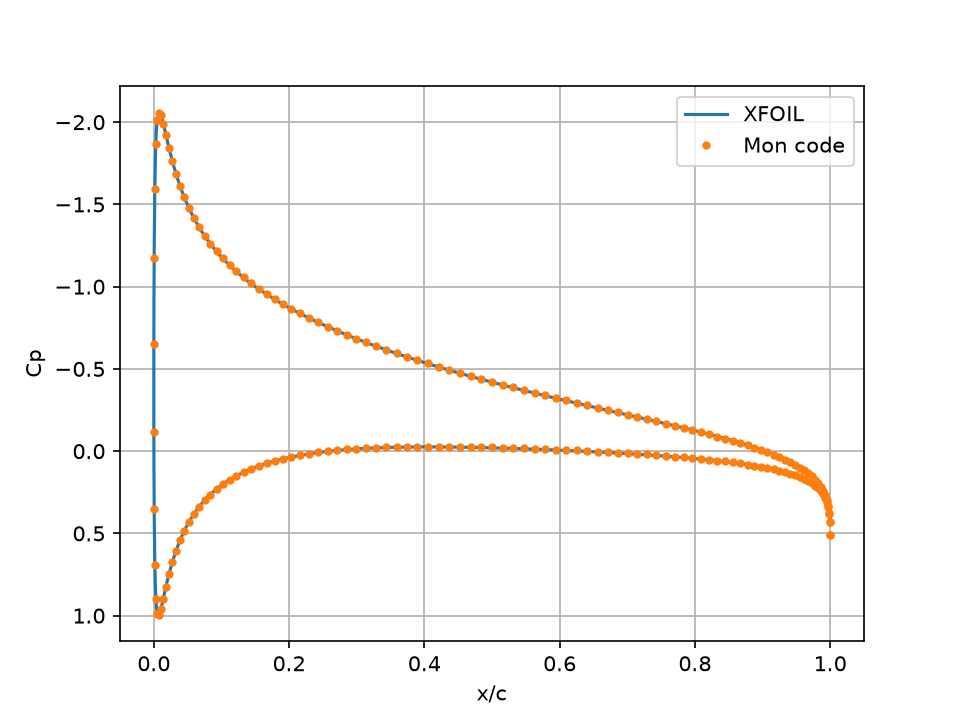
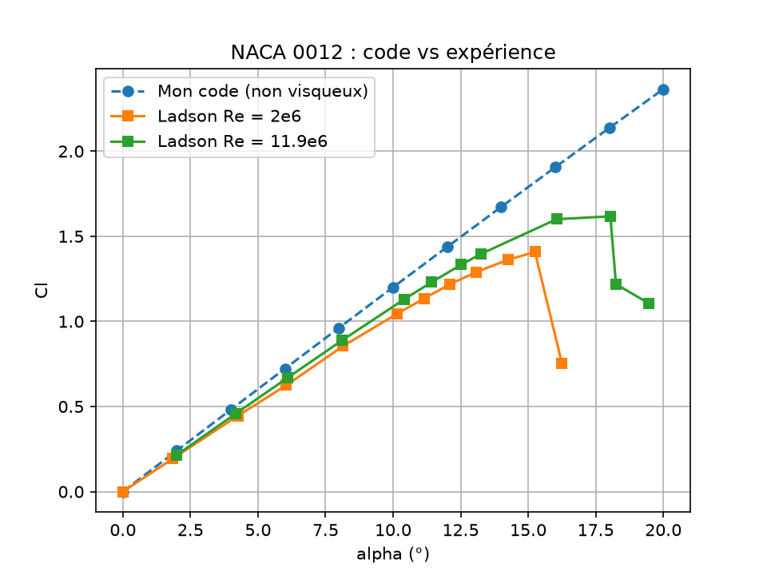

# Analyse d'un profil NACA 0012

## Objectif
Je vais livrer un code Python qui calcule la portance d'un NACA 0012 avec la méthode des panneaux, validé contre XFOIL, puis une simulation Fluent comparée à ce code, avec une explication des écarts.

## Plan
- [x] Étape 1 : géométrie du NACA 0012
- [x] Étape 2 : méthode des panneaux (sources + vortex + Kutta)
- [x] Étape 3 : validation contre XFOIL et données expérimentales
- [ ] Étape 4 : simulation CFD sous Ansys Fluent
- [ ] Étape 5 : comparaison et conclusion

## Méthode
Panneaux plans à sources et vortex d'intensité constante, condition de Kutta au
bord de fuite, écoulement non visqueux et incompressible. Le code est dans `src/`.

## Validation de la méthode des panneaux

| Test | Résultat |
|---|---|
| Cylindre (N = 50 à 100) | Cp exact à l'arrondi machine, flux nul |
| Convergence (α = 5°) | 48 à 398 panneaux : Cl de 0,6012 à 0,6028, erreur < 0,04 % à 198 panneaux |
| Cl vs XFOIL (non visqueux, −4° à 8°) | écart de −0,12 % à −0,14 % |
| Cp à 5° vs XFOIL | écart moyen ≈ 0,002, max ≈ 0,01 (hors bords) |
| Pente dCl/dα | 6,90 par radian (théorie des profils épais ≈ 6,86) |






## Comparaison avec l'expérience (NASA TM-4074, Ladson)

| Essai | Écart sur Cl (petits et moyens angles) | Décrochage |
|---|---|---|
| Re = 2×10⁶, M = 0,15 | ≈ +15 à +17 % | entre 15,25° et 16,25° |
| Re = 11,9×10⁶, M = 0.15 | ≈ +10 % | entre 18,04° et 18,25° |

L'écart diminue quand le Reynolds augmente, ce qui est cohérent avec une origine
visqueuse. Le code ne prédit ni le décrochage ni la traînée (Cd ≈ 0).



## Limites
- Écoulement non visqueux : pas de couche limite, pas de décrochage, pas de traînée.
- Les essais ne sont pas au Reynolds d'un drone (≈ 2,7×10⁵) : l'écart réel y serait
  probablement plus grand (à vérifier avec la simulation Fluent).
- Bord de fuite fermé dans le code ; celui de XFOIL est légèrement ouvert
  (hypothèse non testée pour l'écart de 0,13 %).
- Données expérimentales recopiées depuis les tableaux du rapport.

## Structure du dépôt
- `src/` : code (géométrie, panneaux, comparaisons)
- `results/` : figures et données de référence
- `fluent/` : cas Fluent (à venir)
- `tests/` : réservé aux tests

## Installation
```
pip install -r requirements.txt
```